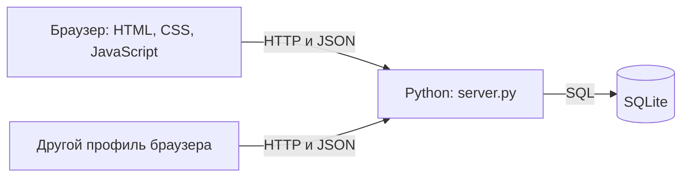

# Архитектура

## Общая схема

Сервер отдаёт интерфейс и API с одного адреса. Отдельного frontend-сервера, сборщика, внешней БД и очереди задач нет. Несколько браузеров используют один сервер и одну базу.

## Сервер

`ThreadingHTTPServer` создаёт обработчики `App` для HTTP-запросов. `dispatch()` разделяет запросы на статические файлы и `/api/...`.

Статические маршруты перечислены явно: `/`, `/app.js`, `/style.css`, `/favicon.svg`. Файл SQLite, резервные копии и произвольные пути сервер не раздаёт.

Для API сервер выполняет:

1. Открывает соединение SQLite и определяет пользователя по cookie.
2. Для POST проверяет JSON и CSRF-токен, кроме входа и регистрации.
3. Проверяет участие в группе перед операциями с её данными.
4. Выполняет запрос и возвращает JSON.
5. Закрывает соединение.

Глобальный `RLock` последовательно пропускает API-запросы внутри процесса. SQLite работает в WAL. Создание группы и добавление её создателя выполняются в явной транзакции. Остальные одиночные записи сохраняются сразу.

## Браузер

`index.html` содержит контейнеры `#app` и `#toast`. `app.js` создаёт экран входа или рабочую область, открывает формы и обрабатывает кнопки. `style.css` отвечает за сетку, таблицы, формы и адаптацию к ширине окна.

В JavaScript находятся:

| Переменная | Назначение |
| --- | --- |
| `me`, `csrf` | Текущий аккаунт и токен изменяющих запросов. |
| `state`, `projectId` | Данные выбранной группы и её номер. |
| `page`, `modal` | Раздел интерфейса и открытая форма. |
| `search`, `statusFilter`, `checkSort`, `memberSort` | Локальные настройки списков. |
| `refreshSeq`, `pendingRefreshes` | Отсечение устаревших ответов и учёт выполняющихся обновлений. |
| `saving` | Защита от повторного сохранения формы. |

`api()` вызывает `fetch()` с cookie того же адреса, передаёт JSON и ограничивает запрос 10 секундами. `esc()` экранирует пользовательские значения перед вставкой в HTML.

## Обновление между окнами

Это периодический опрос, а не WebSocket:

- при старте запрашиваются `/api/me` и `/api/state`;
- видимая вкладка повторяет `/api/state` примерно раз в три секунды;
- при возвращении к вкладке запрашивается обновление;
- во время сохранения и уже выполняющегося обновления лишний опрос не начинается;
- ответы от прежней сессии или более раннего запроса отбрасываются;
- при открытой форме её DOM не перерисовывается, чтобы сохранить ввод;
- после сохранения выполняется принудительное обновление.

При смене группы сначала загружается её полное состояние. На время переключения содержимое отключается через `inert`; группа фиксируется после успешного ответа. Поиск и фильтр результата очищаются.

## Правила доступа

Создавать группу может любой вошедший пользователь. Любой её участник может добавлять зарегистрированных людей, создавать проверки и сохранять результаты. `users.role` не повышается при создании группы. В перечисленных рабочих операциях у `admin` нет дополнительных прав.

Даже `admin` должен иметь строку в `project_members`, чтобы читать группу. `project_members.role` сохранено для совместимости и не предоставляет обход проверки участия. Для сохранения результата дополнительно проверяется, что проверка относится к указанной группе.

## Вход и сессии

Пароль хранится как bcrypt-хеш. После входа создаются секретный токен cookie, его SHA-256 в `sessions` и CSRF-токен. Срок сессии — 12 часов. Cookie имеет `HttpOnly`, `SameSite=Strict`, `Path=/`.

Для изменяющего запроса требуется `X-CSRF-Token`. Если есть заголовок `Origin`, он должен совпадать с `http://` и заголовком `Host`. После пяти неверных входов по одной почте новые попытки блокируются на пять минут; этот счётчик хранится в памяти процесса.

Выход удаляет текущую сессию. Отдельные профили имеют отдельные cookie; вкладки одного профиля используют общий вход.

## Результаты и визуализация

Каждое сохранение добавляет строку `runs`. Состояние проверки выбирается по последнему `id`, а не по времени: несколько сохранений могут иметь одинаковую секунду. Без строки результата используется `not_run`.

`/api/state` считает общее число проверок и количество каждого статуса. Браузер строит SVG-диаграмму и округляет долю `passed / total` до целого процента. Цвета: серый — `not_run`, зелёный — `passed`, красный — `failed`, жёлтый — `blocked`. При пустом списке показывается 0 %. Нажатие карточки счётчика открывает список с нужным фильтром.

История сохраняется в базе, но отдельного экрана истории результатов сейчас нет. При конкурентном сохранении текущим становится последний записанный результат.
