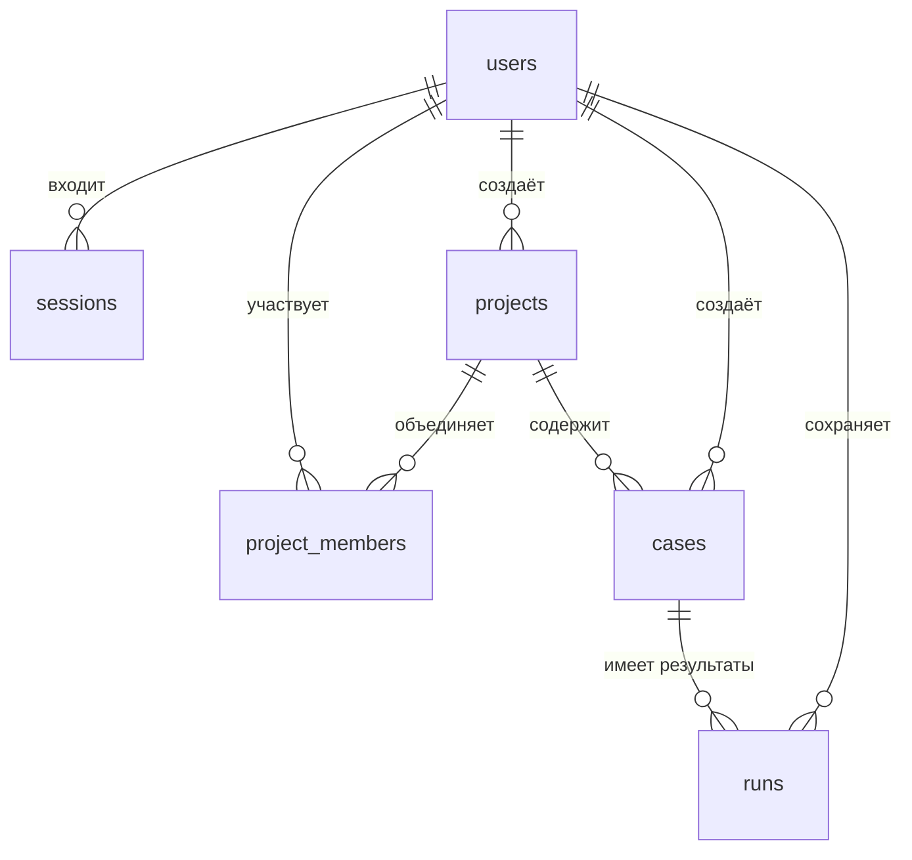

# База данных

Структура новой базы задаётся в [sql/schema.sql](../sql/schema.sql). `testlab/database.py` читает этот файл при запуске. Рабочая база — `testlab.sqlite3`, либо путь из `TESTLAB_DB`.

## Связи

`app_settings` хранит отдельные служебные значения без внешних ключей. `project_members` реализует связь «многие ко многим» между аккаунтами и группами.

## Таблицы

| Таблица | Назначение и поля |
| --- | --- |
| `users` | Аккаунты: `id`, имя `name`, уникальная почта `email`, bcrypt-хеш `password`, тип аккаунта `role`, дата `created_at`. |
| `sessions` | Входы: первичный ключ `token_hash`, пользователь `user_id`, CSRF-токен `csrf`, срок `expires_at`. Секретный токен cookie в открытом виде не хранится. |
| `projects` | Группы: `id`, название `name`, создатель `created_by`, дата `created_at`. `description` осталось от прежней версии. |
| `project_members` | Участие: `project_id`, `user_id`, служебный тип `role`, дата `joined_at`. Пара `(project_id, user_id)` уникальна. |
| `cases` | Проверки: `id`, группа `project_id`, название `title`, шаги `steps`, ожидаемый результат `expected`, создатель `created_by`, дата `created_at`; также поля совместимости. |
| `runs` | Результаты: `id`, проверка `case_id`, статус `status`, комментарий `actual`, автор `executed_by`, время `executed_at`; также поля совместимости. |
| `app_settings` | Служебные отметки `key` / `value`: выполненные переносы и номер стартовой группы. |

`created_by` хранит авторство, но доступ определяется участием в `project_members`. Обычный создатель группы остаётся `user` и участником `member`. Значение `project_members.role` не повышает тип аккаунта.

## Текущий результат проверки

Для одной проверки допустимо несколько `runs`. При сохранении строка добавляется, предыдущая не изменяется. Текущим становится результат с наибольшим `id` для данного `case_id`.

| Значение `status` | Отображение |
| --- | --- |
| `not_run` | Не проверено |
| `passed` | Успешно |
| `failed` | Ошибка |
| `blocked` | Заблокировано |

Если результатов нет, API также возвращает `not_run`. Сохранение `not_run` создаёт новый результат и позволяет сбросить текущий статус. Ограничение допустимых статусов проверяется в Python; в SQL для этого поля нет `CHECK`.

## Форматы и целостность

- Идентификаторы — положительные целые числа.
- Даты операций — текст ISO 8601 в UTC с точностью до секунды.
- `sessions.expires_at` — Unix-время в секундах.
- Почта приводится к нижнему регистру перед записью и поиском.
- `PRAGMA foreign_keys=ON` включается в каждом соединении.
- `busy_timeout=10000` и таймаут соединения задают ожидание занятой базы до 10 секунд.
- `isolation_level=None` включает сохранение одиночных операций сразу; для создания группы явно выполняется `BEGIN IMMEDIATE`.

Индексы `idx_cases_project` и `idx_runs_latest` ускоряют список проверок группы и поиск последнего результата. Каскадное удаление не задано; операций удаления в текущем интерфейсе нет.

## Старые данные и поля

В `cases` сохранены `plan_id`, `requirement_id`, `kind`, `preconditions`. Новая форма не заполняет их; непустые `preconditions` старых проверок могут показываться при открытии. В `runs` остались `environment`, `duration_minutes`; новые результаты используют значения по умолчанию. В `projects` не заполняется `description`.

В существующей старой базе могут быть `requirements`, `plans`, `defects`, `activity`, `invites`. Рабочее API их не использует. Старые `invites` могут читаться при переносе участия. Эти таблицы не удаляются.

`CREATE TABLE IF NOT EXISTS` не меняет существующую таблицу. Поэтому старая база может содержать дополнительные внешние ключи и поля. Для дальнейших изменений схемы нужен явный перенос, а не редактирование только `CREATE TABLE`.

## Инициализация и переносы

`init_db()` выполняет схему и в транзакции проверяет отметки:

| Ключ | Что означает |
| --- | --- |
| `simple_roles` | Выполнен перенос старых типов аккаунтов и участия в упрощённую модель. |
| `default_group` | Стартовая «Общая группа» уже создана; значение — её номер. |
| `account_roles_v2` | Выполнено исправление ошибочно повышенных старых аккаунтов. |

Историческое исправление `account_roles_v2` однократно возвращает прежним аккаунтам, кроме стартового администратора, тип `user` и добавляет стартового администратора в старые группы без администратора. Это перенос старой версии, а не правило выдачи доступа к каждой новой группе. Отметки не следует удалять для обычного перезапуска.

О резервных копиях — [maintenance.md](maintenance.md).
